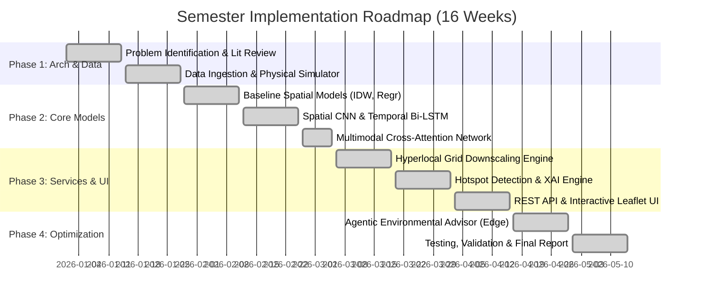

# AeroSense AI: Hyperlocal Air Quality Prediction & Mapping System
### Using Multimodal Deep Learning, Geospatial Intelligence, and Explainable AI

[](https://www.python.org/)
[](https://pytorch.org/)
[](#vets-framework-alignment)
[]()

---

## 1. Executive Summary

Official Air Quality Index (AQI) monitoring stations are capital-intensive and sparse. In major metropolitan areas (such as Delhi-NCR), only a dozen official continuous monitoring stations exist to represent an area of over 1,500 km². However, ground-level air pollution exhibits extreme spatial and temporal heterogeneity due to localized vehicular corridors, industrial clusters, urban topography, and meteorological inversion trapping.

**AeroSense AI** is a cutting-edge multimodal GeoAI and multi-agent platform that bridges the scale gap by downscaling coarse satellite observations (AOD) and sparse station measurements into high-resolution (~250m–500m) continuous ground-level pollution estimates.

The advanced platform features:
- **Spatio-Temporal Graph Attention Networks (ST-GAT)**: Dynamic wind-directed adjacency graph modeling how plumes physically propagate across the urban network.
- **Physics-Informed Neural Network (PINN) Loss**: Penalizes non-physical artifacts by enforcing the 2D Advection-Diffusion Partial Differential Equation.
- **Tri-Agent Collaborative War Room (2026 Trend Booster)**: Multi-agent council (`DiagnosticAgent`, `SimulationAgent`, `PolicyOrchestratorAgent`) orchestrating real-time Graded Response Action Plan (GRAP I-IV) directives.
- **Interactive What-If Scenario Sandbox**: Live parameter sliders (traffic volume -50% to +50%, wind speed, boundary layer height, industrial curbs) recalculating spatial fields in real time.
- **Cleanest Route / Green Path Optimizer**: Dijkstra/A* pathfinding that minimizes cumulative inhaled toxic particulate dose (\(\mu g\)) for commuters, pedestrians, and cyclists.
- **24-Hour Diurnal Time-Lapse Dispersion Player**: Interactive hourly scrubbing from dawn inversion trapping to afternoon ventilation.
- **Animated Wind Streamline Vector Overlay**: Real-time canvas particle streamlines indicating active plume dispersion trajectories.

---

## 2. V.E.T.S Framework Alignment

| V.E.T.S Pillar | Project Implementation Details |
| :--- | :--- |
| **V — Viability** | Ingests data from public monitoring networks (CPCB/OpenAQ), Open-Meteo weather APIs, and Sentinel-5P satellite observations. Built with Python 3, PyTorch, SciPy, and Flask. Includes an offline physical atmospheric simulator to guarantee 100% test reproducibility and zero paid API lock-in. Modularized into a 16-week semester plan. |
| **E — Engineering Depth** | Solves the complex spatial-temporal downscaling problem using a **Multimodal Deep Learning Architecture**: 2D-CNN for spatial raster context, Bi-LSTM with temporal attention for 24-hour meteorological sequences, and dense tabular projections, fused via **Cross-Modal Multi-Head Attention**. Evaluated against IDW and tree baseline models. |
| **T — Trend Alignment (2026 Edge Booster)** | Implements **GeoAI**, **Explainable AI (XAI)** using autograd feature attribution to explain *why* pollution spikes occur (e.g. boundary layer inversion vs. traffic surge), and an **Agentic Environmental Advisor** capable of multi-step diagnostic reasoning and what-if simulation. |
| **S — Social & Industrial Impact** | Empowers citizens with hyperlocal neighborhood-level exposure awareness (e.g., whether it is safe for asthmatics to jog in a specific block) and provides municipal authorities with automated hotspot cluster detection and Graded Response Action Plan (GRAP) interventions. |

---

## 3. Implementation Roadmap (16-Week Semester Plan)



---

## 4. System Architecture

```
                                  DATA INGESTION
               ┌───────────────────────┼───────────────────────┐
               ▼                       ▼                       ▼
      [Ground Stations]       [Satellite Rasters]      [Weather Series]
       OpenAQ / CPCB            Sentinel-5P AOD          Open-Meteo
               │                       │                       │
               └───────────────────────┼───────────────────────┘
                                       ▼
                       [Spatial-Temporal Synchronizer]
                                       │
            ┌──────────────────────────┼──────────────────────────┐
            ▼                          ▼                          ▼
     [Spatial Patch]            [Temporal Seq]             [Tabular Geo]
     (4, 5, 5) Tensor          (24, 8) Tensor             (12,) Vector
            │                          │                          │
            ▼                          ▼                          ▼
      [Spatial 2D-CNN]        [Temporal Bi-LSTM]         [Dense Tabular]
     Embedding: ℝ^32            Embedding: ℝ^32          Embedding: ℝ^32
            │                          │                          │
            └──────────────────────────┼──────────────────────────┘
                                       ▼
                     [Cross-Modal Multi-Head Attention]
                                       │
                                       ▼
                              [Fusion MLP Head]
                                       │
            ┌──────────────────────────┼──────────────────────────┐
            ▼                          ▼                          ▼
      [PM2.5 / PM10 / NO2]     [Explainable AI]       [Hyperlocal Grid]
      Concentrations & AQI       Feature Drivers       Downscaled Maps
            │                          │                      │
            └──────────────────────────┼──────────────────────┘
                                       ▼
                     [Agentic Environmental Advisor]
                     [Interactive Leaflet Dashboard]
```

---

## 5. Mathematical Formulation

### 1. Spatial Downscaling & Baseline IDW Interpolation
Traditional Inverse Distance Weighting estimates concentration $\hat{C}(x)$ at point $x$:
$$\hat{C}_{\text{IDW}}(x) = \frac{\sum_{i=1}^N d(x, x_i)^{-p} C_i}{\sum_{i=1}^N d(x, x_i)^{-p}}$$
Where $d(x, x_i)$ is the Euclidean distance and $p=2.0$.

### 2. Multimodal Cross-Attention Fusion
Given spatial representation $h_{\text{spat}} \in \mathbb{R}^d$, temporal representation $h_{\text{temp}} \in \mathbb{R}^d$, and tabular representation $h_{\text{tab}} \in \mathbb{R}^d$, we form token matrix $H = [h_{\text{spat}}, h_{\text{temp}}, h_{\text{tab}}]^\top \in \mathbb{R}^{3 \times d}$.

The cross-modal attention is computed as:
$$\text{Attention}(Q, K, V) = \text{softmax}\left(\frac{Q K^\top}{\sqrt{d_k}}\right) V$$
where $Q = H W_Q, K = H W_K, V = H W_V$. The contextualized tokens are concatenated and projected through a multi-layer perceptron to predict multi-target concentrations.

### 3. Gradient-Based Explainable AI (XAI)
For any predicted output $\hat{y}$, feature attribution $A_i$ for input feature $x_i$ is computed via gradient-input sensitivity:
$$A_i = \left| \frac{\partial \hat{y}}{\partial x_i} \cdot x_i \right|$$
Attributions are grouped into physical factors: Boundary Layer Trapping, Vehicular Traffic, Industrial Emissions, Wind Ventilation, Satellite Optical Column, and Hygroscopic Humidity.

---

## 6. Project Directory Layout

```
hyperlocal-aqi-system/
├── config.py                      # Geographic bbox, pollutants, neural hyperparams
├── requirements.txt               # Dependencies
├── README.md                      # Documentation
│
├── data/                          # Data Ingestion & Preprocessing
│   ├── generator.py               # Atmospheric physics simulation & dataset generator
│   ├── weather_fetcher.py         # Open-Meteo & weather caching
│   ├── station_fetcher.py         # Ground station fetcher & nearest query
│   ├── satellite_fetcher.py       # Sentinel-5P AOD raster & spatial patch extractor
│   └── preprocessor.py            # Spatial-temporal alignment & PyTorch Dataset
│
├── models/                        # AI & Deep Learning Models
│   ├── baselines.py               # IDW, Nearest Station, and Tabular MLP
│   ├── spatial_cnn.py             # 2D Convolutional neural network
│   ├── temporal_lstm.py           # Bi-LSTM with temporal attention pooling
│   ├── multimodal_fusion.py       # Multi-branch cross-attention fusion architecture
│   ├── xai_engine.py              # Gradient-based feature attribution engine
│   └── train_eval.py              # Training loop & benchmark evaluation
│
├── services/                      # Analytics & Reasoning Services
│   ├── grid_engine.py             # Continuous dense downscaling & point prediction
│   ├── hotspot_detector.py        # 8-connected component spatial clustering
│   └── advisor_agent.py           # 2026 Trend Booster: Agentic Environmental Advisor
│
├── api/                           # Backend Application
│   └── app.py                     # Flask REST API endpoints & static file server
│
├── static/                        # Frontend UI
│   ├── index.html                 # Interactive Leaflet web dashboard
│   ├── styles.css                 # Modern dark glassmorphism styling
│   └── app.js                     # Leaflet GIS, click-to-inspect, XAI charts, advisor chat
│
└── tests/                         # Comprehensive Test Suite
    ├── test_data_pipeline.py      # Simulation & tensor alignment tests
    ├── test_models.py             # Model forward pass & XAI tests
    ├── test_services.py           # Grid engine & hotspot detector tests
    └── test_api.py                # REST API integration tests
```

---

## 7. Setup & Execution Instructions

### Prerequisites
- Python 3.10+
- PyTorch 2.0+

### Installation
```bash
cd hyperlocal-aqi-system
pip install -r requirements.txt
```

### Running Unit Tests
```bash
python -m unittest discover tests
```

### Training Models & Generating Benchmark Evaluation
```bash
python models/train_eval.py
```

### Launching the Interactive Web Dashboard
```bash
python api/app.py
```
Open your browser and navigate to: **`http://localhost:5000`**

---

## 8. REST API Reference

| Method | Endpoint | Description |
| :--- | :--- | :--- |
| `GET` | `/api/status` | System configuration, bounding box, active device |
| `GET` | `/api/stations` | List of ground monitoring stations with live readings |
| `GET` | `/api/grid` | Dense continuous downscaling grid (`?pollutant=pm25\|aqi`) |
| `POST` | `/api/predict/point` | Predict AQI at any arbitrary unmonitored coordinate `{"lat", "lon"}` |
| `GET` | `/api/hotspots` | Active detected pollution hotspots and emergency advisories |
| `POST` | `/api/explain` | Explainable AI (XAI) feature attribution breakdown for a coordinate |
| `POST` | `/api/advisor/query` | Agentic AI environmental advisor query |
| `GET` | `/api/benchmarks` | Model comparative evaluation metrics (RMSE, MAE, R², Pearson r) |
| `GET` | `/api/db/stats` | SQLite database health, table record counts, and storage footprint |
| `GET` | `/api/db/history/stations` | Query historical station telemetry records stored in SQLite |
| `GET` | `/api/db/history/simulations`| Audit log of What-If scenario simulations |
| `GET` | `/api/db/history/routes` | Historical green commute pathfinding optimization logs |

---

## 9. Spatiotemporal Database Architecture

AeroSense AI includes a thread-safe, embedded **SQLite 3** relational storage engine (`data_store/aerosense.db`) configured with **WAL (Write-Ahead Logging)** mode for zero-latency concurrent reads and writes:
- **`stations_history`**: Historical CPCB ground station telemetry (indexed by `station_id` and `timestamp`).
- **`hyperlocal_predictions`**: Downscaled model prediction snapshots across spatial grid points.
- **`whatif_simulations`**: Audit trail of environmental policy scenarios and GRAP action plans.
- **`green_routes`**: Commuter dose-minimization route optimization queries.

---

## 10. Research & Development Team

- **Aparvan Sharma** — Machine Learning Engineer & GIS Specialist
- **Annish Sen** — Deep Learning Researcher & Full-Stack Developer
